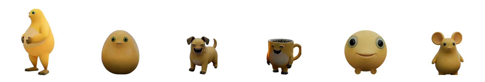

# 奶小蛙 · macOS 升级版

> 基于原作者 [jiasjdia/naiwa](https://github.com/jiasjdia/naiwa) 的 Windows 桌宠源码，移植到 Apple Silicon macOS 原生运行，**并在原版基础上新增了形态、素材、语音和动作**。不需要 Wine，也不需要虚拟机。是我身为奶家人对奶娃及其衍生异形形象的喜爱让我改进了以下这个好玩的小软件，方便的话，顺手给个star呗【笑】


从左到右：奶蛙（原版）、奶蛋、奶狗、奶杯、奶豆、奶鼠。右键菜单里可以随时切换，也可以让六种形态一起出来。

## 这是升级版，不是单纯移植

原版只有一只奶蛙、一套 320×305 的大笑帧、一段笑声。这个仓库在保留原版玩法（Q 弹、拖动、回弹、分裂、物理堆积、合体）的同时，加了下面这些功能：

### 1. 六种形态

| 形态 | 来源 |
| --- | --- |
| 奶蛙 | 原版素材（已换高清帧） |
| 奶蛋 | B 站原片 L2D 形象 |
| 奶狗 | B 站「奶史_」原片 |
| 奶杯 | B 站沙滩片（奶蛋 + 奶杯同框） |
| 奶豆 | B 站博物馆原片 |
| 奶鼠 | 原片形象 + 奶蛋笑脸移植 |

菜单里可以逐只切换、全体形态一起出来、收起其它形态。

### 2. 高清大笑素材

大笑帧从原版 320×305 换成 720×686 的原片帧，同一个窗口尺寸下清晰度约 2.25 倍。奶蛋的笑帧还用待机肤色做过一次调色，避免笑的时候突然变暗。

### 3. 原片语音

从 B 站原片里抽出笑声，按形态分配声线（同一段音频做半音变调）：

- 奶蛙：原片 A 组，低沉
- 奶蛋、奶狗、奶杯、奶豆、奶鼠：原片 B 组，按形态升降调

群笑不再是简单地把同一段音频叠 6 遍（等距 15ms 叠加会形成梳状滤波，听起来像金属白噪）。现在改成同一段原声按 0 / 120 / 260ms 错开三层再限幅，听感更接近「一群一起笑」。

### 4. 更多动作

在「捧腹大笑」之外新增：蹦一下、歪个头、招手、摇一摇、跳。不同形态按各自素材可用性挑动作。

### 5. macOS 原生层

- AppKit 无边框透明置顶窗口，CALayer 逐帧贴图
- 按像素 alpha 做鼠标穿透（透明区域点得到桌面）
- 原生右键菜单和「使用说明」窗口
- UNIX 域套接字做单实例与动作传递
- Carbon 全局快捷键，不需要辅助功能授权
- LaunchAgent 开机自启

> 原版的 Windows 专用实现保留为 `pet_runtime_win32.py`，方便对照。

## 系统要求

- Apple Silicon Mac（M1/M2/M3/M4/M5）
- macOS 13 及以上
- Python 3.12

## 从源码运行

```bash
git clone https://github.com/kskbl1716/naiwa-macos.git
cd naiwa-macos

python3.12 -m venv .venv
source .venv/bin/activate
pip install -r requirements.txt
pip install pyobjc-framework-Cocoa pyobjc-framework-Quartz

python run_mac.py
```

第一次启动会在屏幕右下角出现一只奶蛙。同一时间只允许一个实例，重复启动会唤醒已经在跑的那只。

## 操作

| 操作 | 效果 |
| --- | --- |
| 移动鼠标 | 待机时眼神跟随 |
| 单击身体 | 点击部位局部 Q 弹 |
| 原地长按后松手 | 约 1.5 秒蓄满，增强回弹 |
| 按住左键移动 | 拎起拖动，放下后回弹 |
| 3 秒内点击身体 10 次 | 完整播放有声大笑 |
| 大笑时 2 秒内再点 8 次 | 喷出分身，可继续递归分裂 |
| 右键宠物 | 打开功能菜单 |
| 菜单「形态」 | 切换奶蛙 / 奶蛋 / 奶狗 / 奶杯 / 奶豆 / 奶鼠 |
| 菜单「全体形态（一起出来）」 | 六种形态同时登场 |
| 菜单「捧腹大笑 / 停止大笑」 | 控制单只或全群大笑 |
| 菜单「复制分身」 | 新增一只分身 |
| 拖动同档身体重叠后松手 | 合体升一档 |
| 菜单「归一」 | 分身收回本体 |

### 快捷键

| 快捷键 | 作用 |
| --- | --- |
| Control+Option+1 | 全体大笑 |
| Control+Option+C | 复制（准备一只分身） |
| Control+Option+V | 粘贴到鼠标位置 |
| Control+Option+Q | 退出 |

快捷键走 Carbon `RegisterEventHotKey`，不要求辅助功能授权。如果某个组合被别的 App 占用，注册会失败并写进日志，其它功能不受影响。

## 与原版的技术差异

| 文件 | 说明 |
| --- | --- |
| `mac_tk.py`（新增） | 用 AppKit 实现原代码用到的 tkinter 子集：窗口、Canvas、图片、定时器、菜单、事件分发 |
| `run_mac.py`（新增） | 启动器：把 tkinter 替换成 `mac_tk`，并替换工作区换算、初始位置、说明窗口等平台相关函数 |
| `pet_runtime.py`（重写） | 原版用 kernel32 命名互斥量和 RegisterHotKey；macOS 版改成 UNIX socket + Carbon 热键 |
| `pet_runtime_win32.py`（保留） | 原 Windows 实现，供对照 |
| `assets/forms/`（新增） | 六形态素材、各自的 manifest 与动作片段 |

其余动画、物理、音频、分裂业务逻辑沿用上游源码。

## 素材来源与版权

- 原项目：[jiasjdia/naiwa](https://github.com/jiasjdia/naiwa)（Windows 版作者）
- 开发时参考：[timerring/codex-pet-naiwa](https://github.com/timerring/codex-pet-naiwa)（MIT，许可文本见 `licenses/reference-naiwa-MIT.txt`）
- 角色动画与语音来自原项目素材，以及 B 站公开视频（「奶史_」「宅家听雨中」「Finla幻想天国」「Tiamo-叛逆っ」「秋月_奶家人」等）
- 第三方依赖许可见 `THIRD_PARTY_NOTICES.md` 和 `licenses/`

角色形象、原片视频和音频的权利归各自权利人所有。本仓库仅供个人学习与交流，**请勿商用**；如果原作者对搬运有异议，会立即删除相关素材。

## 已知限制

- 只支持 Apple Silicon，Intel Mac 未测试
- 打包出的 `.app` 没有做公证，第一次打开要右键或双指按触控板 →「打开」
- 奶豆、奶鼠没有原片大笑镜头：奶鼠用奶蛋笑脸移植，奶豆保留原表情，触发大笑时改用真实动作代替
- 语音是按形态变调合成的，不是每个形态的独立原声

## 目录结构

```
pet_app.py            # 主程序：窗口、动画、交互
pet_group.py          # 宠物群：菜单、群笑、分裂、合体
pet_physics.py        # 物理：下落、反弹、堆积
pet_audio.py          # 音频播放
pet_eyes.py           # 眼神跟随
pet_runtime.py        # macOS 单实例与全局热键
pet_runtime_win32.py  # 原 Windows 实现（对照用）
mac_tk.py             # AppKit 版 tkinter 子集
run_mac.py            # macOS 启动器
assets/               # 动画帧、眼部图层、六形态素材、语音
media/                # 音频文件（大笑、群笑混音）
tools/                # 测试与打包脚本
docs/                 # 预览图
```

## 调试开关

- `NAIWA_DEBUG=1`：把鼠标命中判定和事件分发写到 `/tmp/naiwa-mac-debug.log`
- `NAIWA_TRACE=1`：记录分裂调用栈到 `/tmp/naiwa-split-trace.log`
- `NAIWA_CACHE_MB`：帧缓存上限，默认 128
- `NAIWA_DATA_DIR`：指定运行数据目录（日志、位置记忆、单实例 socket）

## 致谢

感谢原作者的奶小蛙，以及所有在 B 站分享奶家人视频的创作者。这个 macOS 升级版只是把喜欢的桌宠搬到了 Mac 上，并给它多加了几套衣服和表情。最后有什么问题欢迎大家到这里告诉我
